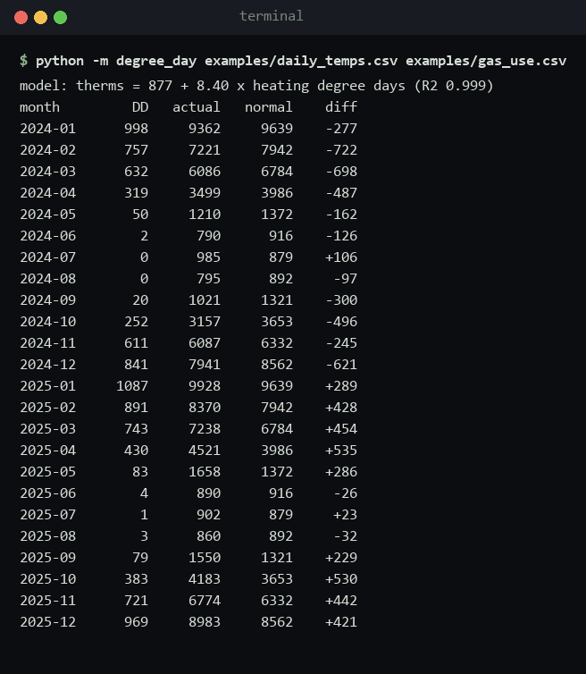

# degree-day-normalizer

[](https://github.com/yassine2med/degree-day-normalizer/actions/workflows/ci.yml)  

Adjusts monthly utility use for weather using heating or cooling degree days.



## What it is for

A cold winter makes a gas bill look bad even when the building ran well. An energy manager, facility manager or project engineer needs to compare one year with another, or check whether an energy project saved anything, so utility use has to be adjusted for weather. This tool turns daily temperatures into monthly heating or cooling degree days (a measure of how far the outdoor temperature is from a balance point), fits a straight-line weather model to monthly usage, and shows what each month would have used in typical weather.

## Install

```
git clone <this repo>
cd degree-day-normalizer
pip install -r requirements.txt pytest
```

Python 3.10 or newer. No runtime dependencies.

## How to use

| I want to | Command |
| --- | --- |
| Normalize monthly gas use for heating weather | `PYTHONPATH=src python -m degree_day examples/daily_temps.csv examples/gas_use.csv` |
| Use cooling degree days, for example with electric data | `PYTHONPATH=src python -m degree_day TEMPS USAGE --mode cooling --column kwh` |
| Read a usage column other than `therms` (default) | `PYTHONPATH=src python -m degree_day TEMPS USAGE --column kwh` |
| Change the 65 F balance point | `PYTHONPATH=src python -m degree_day TEMPS USAGE --base 60` |
| See all options | `PYTHONPATH=src python -m degree_day --help` |

Temperature file columns: `date,mean_temp_f`. Usage file columns: `month,<column>`. On Windows PowerShell set `$env:PYTHONPATH = "src"` first. In the output, `diff` is actual minus normal.

Worked example:

```
PYTHONPATH=src python -m degree_day examples/daily_temps.csv examples/gas_use.csv
```

Output (the example data is invented):

```
model: therms = 877 + 8.40 x heating degree days (R2 0.999)
month         DD   actual   normal    diff
2024-01      998     9362     9639    -277
2024-02      757     7221     7942    -722
2024-03      632     6086     6784    -698
2024-04      319     3499     3986    -487
2024-05       50     1210     1372    -162
2024-06        2      790      916    -126
2024-07        0      985      879    +106
2024-08        0      795      892     -97
2024-09       20     1021     1321    -300
2024-10      252     3157     3653    -496
2024-11      611     6087     6332    -245
2024-12      841     7941     8562    -621
2025-01     1087     9928     9639    +289
2025-02      891     8370     7942    +428
2025-03      743     7238     6784    +454
2025-04      430     4521     3986    +535
2025-05       83     1658     1372    +286
2025-06        4      890      916    -26
2025-07        1      902      879    +23
2025-08        3      860      892     -32
2025-09       79     1550     1321    +229
2025-10      383     4183     3653    +530
2025-11      721     6774     6332    +442
2025-12      969     8983     8562    +421
```

## How it works

1. For each day, heating degree days are `max(0, base - mean temp)`; cooling is `max(0, mean temp - base)`.
2. Days are summed by month. A month with missing days is dropped, not guessed.
3. Least squares fits `usage = baseload + slope x degree days` across the months that have both usage and weather.
4. "Normal" degree days for each calendar month are the average of that month across all years in the temperature file.
5. Normalized use is the model evaluated at the normal degree days. The R2 value tells you how well weather explains the bill.

## Limits

- One variable, one straight line. Buildings with both heating and cooling in the same data need two runs.
- Normals come only from the years in your temperature file (three in the example). Use a long record for real work.
- Monthly billing periods are treated as calendar months.

## License

MIT, see LICENSE. Author: Yassine Emhamed.
